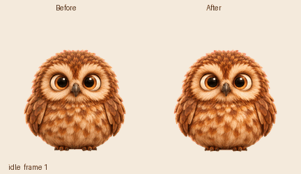

# 小知 · 圆胖猫头鹰

一只圆滚滚的棕色小猫头鹰：大金色眼睛、短翅膀、小脚爪。
造型参考选定的 Pigwidgeon（小猪）Q 版概念，使用内置 imagegen 制作。


## 文件

| 路径 | 内容 |
| --- | --- |
| [assets/spritesheet.png](assets/spritesheet.png) | 最终透明精灵图，用于宠物客户端接入 |
| [pet.json](pet.json) | 布局、动作帧数、时间和视线方向 |
| [previews/all-states.gif](previews/all-states.gif) | 九种动作总览 |
| [previews/all-states.mp4](previews/all-states.mp4) | 视频预览 |
| [previews/look-loop.gif](previews/look-loop.gif) | 十六个视线方向 |
| [previews/idle-jump-idle.gif](previews/idle-jump-idle.gif) | 待机与跳跃衔接 |
| [source/](source/) | 当前有效主体、动作条、参考图和布局参考 |
| [prompts/](prompts/) | 实际使用的生成提示词，包含跳跃修订记录 |
| [qa/](qa/) | 最终检查图和校验记录 |
| [SHA256SUMS](SHA256SUMS) | 仓库素材的完整性校验值 |

## 精灵图布局

- Pets v2，透明 PNG，1536 × 2288 像素。
- 8 列 × 11 行，每格 192 × 208 像素。
- 前九行动作帧数依次为：6、8、8、4、5、8、6、6、6。
- 最后两行是十六个顺时针视线方向；0° 向上，90° 向右。
- 普通待机使用 `idle`；`running` 表示专注处理，左右移动使用拍翅动作。

| 行（从 0 开始） | 状态 | 帧数 |
| --- | --- | --- |
| 0 | 待机 idle | 6 |
| 1 | 向右移动 running-right | 8 |
| 2 | 向左移动 running-left | 8 |
| 3 | 挥翅 waving | 4 |
| 4 | 小跳 jumping | 5 |
| 5 | 受挫 failed | 8 |
| 6 | 等待 waiting | 6 |
| 7 | 思考 running | 6 |
| 8 | 检查 review | 6 |
| 9–10 | 视线方向 | 16 |

## 循环连贯性修订

本次重画了待机、拍翅、跳跃、受挫、等待、思考和检查的过渡姿势，并固定拍翅时的脚部对齐点。
等待动作按自身生成姿势重排为更完整的往返循环。短翅挥手和十六个视线方向保留上一版，视线行逐像素一致。



对比图左侧是旧版，右侧是新版，使用相同帧数、画面尺寸和帧时长。

| 检查项 | 旧版 | 新版 |
| --- | --- | --- |
| 待机身体高度差 | 12 px | 0 px |
| 向右拍翅足底水平漂移 | 9.86 px | 1.51 px |
| 向左拍翅足底水平漂移 | 8.67 px | 1.39 px |

其余逐帧数据见 [qa/motion-comparison.json](qa/motion-comparison.json)。其中图像差值衡量相邻画面的变化幅度，不代表主观流畅度评分。
当前格式的每个动作固定为 4–8 帧；本次通过较小的姿势变化和更稳定的坐标改善循环，帧数与时长不变。
受挫表情、等待和拍翅动作因此更克制。

## 检查记录

2026-11-08 制作时，最终文件通过精灵图结构、透明背景、边缘清理、动作几何检查和 Pets 预检。
四个基本视线方向通过独立盲审；少量中间方向的单轴偏移较细微，记录在 `qa/` 的警告中。
源图中的洋红色背景用于抠图，最终 `assets/spritesheet.png` 使用透明背景。

提示词是制作时的记录。`source/references/` 保存修复前的精灵图和原造型参考；历史提交保留之前的制作版本。
仓库中的校验报告副本已将本机绝对路径改成相对路径，精灵图字节保持不变。

素材完整性检查（macOS / Linux）：

```sh
shasum -a 256 -c SHA256SUMS
```
